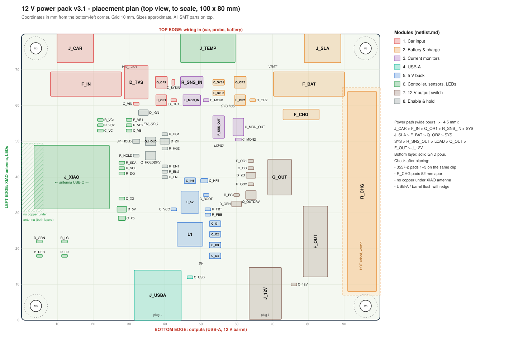

# Placement plan (v3.1, 2026-11-14)



To-scale drawing: `04-placement.svg` (open in a browser), rendered as `04-placement.png`. The SVG, the PNG and the table below come from `04-placement-gen.py`; edit the coordinates there and re-run:

```
python3 blocks/04-placement-gen.py blocks/04-placement.svg table.md   # then paste table.md below
```

The generator checks that no two parts overlap, that every part is on the board, and that the mounting holes are clear.

## How it reaches KiCad

**Superseded for the board itself:** the board was re-placed at 100 × 70 mm by `kicad/gen/place_pcb.py` later on 2026-11-14; that script's table is the current placement. This document is the first plan.

`kicad/gen/gen_pcb.py` read this table on 2026-11-14 and wrote `kicad/powerpack.kicad_pcb` with every footprint at these coordinates (board 100 × 80 mm, origin at the bottom-left corner, y up; in KiCad the board's top-left corner sits at (50, 50) on the page). It centres each footprint on its outline, turns the parts listed in its `ROT` table, and nudged 23 small parts by up to about 1 mm so that no courtyards overlap. The board now belongs to the owner: further moves are made in KiCad, not here.

- **Edges:** the top edge takes the wiring terminals (wire entries facing out). The bottom edge takes the outputs (USB-A and barrel jack openings flush with the edge). The left edge takes the XIAO antenna (no copper under it on either layer) and the two LEDs (light pipe or hole in the case).
- **J_XIAO:** USB-C end to the right, antenna end at the left edge (rotation 270°). Check where the antenna sits on your module: on the XIAO ESP32-C6 it is at the end opposite the USB-C connector.
- **R_CHG:** AC10 footprint `pwrpack:R_Axial_Vishay_AC10_EK_L44.0mm_D8.0mm_P52.00mm` along the right edge, CHG_F pad at the top, VBAT pad at the bottom; mount it raised 3–5 mm.
- **Terminal blocks (J_CAR, J_SLA, J_TEMP):** placed at 0°. Their bodies overhang the top edge by about 2 mm. **Check in the KiCad 3D viewer that the wire entries face the top edge;** if they face inward, turn each block 180°.
- **TP1–TP8:** not in this table; parked in two columns at x 80–84, y 38–50.

## Checks after layout (kicad-cli, run here)

1. DRC with schematic parity: `kicad-cli pcb drc --schematic-parity kicad/powerpack.kicad_pcb`. On 2026-11-14, as placed and unrouted: 0 footprint errors, 0 shorts, 0 courtyard overlaps; 183 unconnected pads and silkscreen warnings only.
2. The 3557-2 holders: pads 1 and 2 are one clip, 3 and 4 the other ([DS Keystone 3557]: 3.4 mm within a pair, 13.5 mm between pairs). The KiCad symbol puts 1+2 on the supply side.
3. CSD18543Q3A (Q_OR1, Q_OR2): the stock NexFET footprint has one drain pad, 5, under pins 5–8 and the tab.
4. The power path can be poured at 4.5 mm or more: J_CAR → F_IN → Q_OR1 → R_SNS_IN → SYS, J_SLA → F_BAT → Q_OR2 → SYS, SYS → R_SNS_OUT → LOAD → Q_OUT → F_OUT → J_12V. The `Power` net class (1.5 mm tracks, 0.3 mm clearance) covers these nets and GND.

## Coordinates (part centres, mm from the bottom-left corner)

| Module | Designator | X (mm) | Y (mm) | Orientation / note |
|---|---|---:|---:|---|
| 1. Car input | C_OR1 | 42.5 | 61.5 | at U_OR1 VCAP |
| 1. Car input | C_SYSIN | 42.35 | 66.5 | turned 90 deg in the gap between Q_OR1 and R_SNS_IN |
| 1. Car input | C_VIN | 32 | 60.5 | below D_TVS |
| 1. Car input | D_TVS | 32 | 66.5 | SMC turned 90 deg (pads along y), either way round |
| 1. Car input | F_IN | 18 | 66 | 3557-2 lying along x; fuse inserts from above |
| 1. Car input | J_CAR | 15 | 76 | screw entries face top edge; pin 1 (+) on the right |
| 1. Car input | Q_OR1 | 39 | 66.5 | source pins toward D_TVS, drain toward R_SNS_IN |
| 1. Car input | U_OR1 | 39 | 61.5 | next to Q_OR1 gate |
| 2. Battery & charge | C_OR2 | 64.5 | 61.5 | at U_OR2 VCAP |
| 2. Battery & charge | C_SYS1 | 55 | 66.5 | SYS hub |
| 2. Battery & charge | C_SYS2 | 55 | 63.5 | SYS hub |
| 2. Battery & charge | F_BAT | 80.2 | 66 | 3557-2 lying along x |
| 2. Battery & charge | F_CHG | 78 | 57.5 | UMT 250 along x: SYS left, CHG_F right |
| 2. Battery & charge | J_SLA | 84 | 76 | screw entries face top edge |
| 2. Battery & charge | Q_OR2 | 61 | 66.5 | source pins toward F_BAT (VBAT), drain toward SYS hub |
| 2. Battery & charge | R_CHG | 95 | 36 | AC10 along y, raised 3-5 mm; CHG_F pad top (y 62), VBAT pad bottom (y 10) |
| 2. Battery & charge | U_OR2 | 61 | 61.5 |  |
| 3. Current monitors | C_MON1 | 51.5 | 61.5 |  |
| 3. Current monitors | C_MON2 | 60.5 | 50.5 |  |
| 3. Current monitors | R_SNS_IN | 47.5 | 66.5 | 2512 along x; Kelvin taps to U_MON_IN |
| 3. Current monitors | R_SNS_OUT | 55 | 54 | 2512 along y: SYS at top, LOAD at bottom |
| 3. Current monitors | U_MON_IN | 47.5 | 61.5 |  |
| 3. Current monitors | U_MON_OUT | 60.5 | 54 |  |
| 4. USB-A | C_USB | 47 | 12 |  |
| 4. USB-A | J_USBA | 38 | 7 | opening at bottom edge |
| 5. 5 V buck | C_BOOT | 51.5 | 35 |  |
| 5. 5 V buck | C_HF5 | 51 | 39 | right at VIN/PGND |
| 5. 5 V buck | C_IN5 | 47 | 39 | right at VIN/PGND |
| 5. 5 V buck | C_O1 | 54 | 27 |  |
| 5. 5 V buck | C_O2 | 54 | 24 |  |
| 5. 5 V buck | C_O3 | 54 | 21 |  |
| 5. 5 V buck | C_O4 | 54 | 18 |  |
| 5. 5 V buck | C_VCC | 42.5 | 31 |  |
| 5. 5 V buck | L1 | 47 | 24 | SW node short to U_5V |
| 5. 5 V buck | R_FBB | 52 | 29.5 |  |
| 5. 5 V buck | R_FBT | 52 | 31 | keep FB trace away from L1/SW |
| 5. 5 V buck | U_5V | 47 | 33 | pin 1 top-left; thermal pad via array to GND |
| 6. Controller, sensors, LEDs | C_VB | 30 | 53 |  |
| 6. Controller, sensors, LEDs | C_VC | 22 | 53 |  |
| 6. Controller, sensors, LEDs | C_X3 | 28 | 34 |  |
| 6. Controller, sensors, LEDs | C_X5 | 28 | 28.5 |  |
| 6. Controller, sensors, LEDs | D_5V | 28 | 31 | anode right (5V), cathode left (XIAO_5V) |
| 6. Controller, sensors, LEDs | D_GRN | 5 | 22 | at left edge for a light pipe |
| 6. Controller, sensors, LEDs | D_RED | 5 | 18 | at left edge for a light pipe |
| 6. Controller, sensors, LEDs | J_TEMP | 52 | 76 | screw entries face top edge; pin 1 GND on the left |
| 6. Controller, sensors, LEDs | J_XIAO | 14 | 40 | socket; ANTENNA END AT LEFT EDGE, USB-C facing right |
| 6. Controller, sensors, LEDs | R_DQ | 28 | 41 |  |
| 6. Controller, sensors, LEDs | R_LG | 12 | 22 |  |
| 6. Controller, sensors, LEDs | R_LR | 12 | 18 |  |
| 6. Controller, sensors, LEDs | R_SCL | 28 | 42.5 |  |
| 6. Controller, sensors, LEDs | R_SDA | 28 | 44 |  |
| 6. Controller, sensors, LEDs | R_VB1 | 30 | 56 |  |
| 6. Controller, sensors, LEDs | R_VB2 | 30 | 54.5 |  |
| 6. Controller, sensors, LEDs | R_VC1 | 22 | 56 |  |
| 6. Controller, sensors, LEDs | R_VC2 | 22 | 54.5 |  |
| 7. 12 V output switch | C_12V | 76 | 10 |  |
| 7. 12 V output switch | C_OG | 64 | 42.5 |  |
| 7. 12 V output switch | D_OEN | 60 | 32.5 | anode OUT_EN, cathode toward XIAO |
| 7. 12 V output switch | D_ZO | 64 | 40.5 | cathode toward LOAD |
| 7. 12 V output switch | F_OUT | 82 | 22 | 3557-2 along y: 12V_SW top, 12V_OUT bottom |
| 7. 12 V output switch | J_12V | 68 | 7.5 | barrel opening at bottom edge |
| 7. 12 V output switch | Q_OUT | 72 | 40 | TO-252, drain tab toward bottom (F_OUT) |
| 7. 12 V output switch | Q_OUTDRV | 64 | 35 |  |
| 7. 12 V output switch | R_OG1 | 64 | 44.5 |  |
| 7. 12 V output switch | R_OG2 | 64 | 38 |  |
| 7. 12 V output switch | R_PG | 60 | 35 |  |
| 8. Enable & hold | C_EN | 40 | 40 | close to U_5V EN |
| 8. Enable & hold | D_IGN | 34 | 58 | anode left (VIN_CAR) |
| 8. Enable & hold | D_ZH | 40 | 50 | cathode toward SYS side |
| 8. Enable & hold | JP_HOLD | 32 | 50 |  |
| 8. Enable & hold | Q_HOLD | 36 | 50 | wired by pad number (see netlist) |
| 8. Enable & hold | Q_HOLDDRV | 36 | 46 |  |
| 8. Enable & hold | R_EN1 | 40 | 43 |  |
| 8. Enable & hold | R_EN2 | 40 | 41.5 |  |
| 8. Enable & hold | R_HG1 | 40 | 52 |  |
| 8. Enable & hold | R_HG2 | 40 | 48 |  |
| 8. Enable & hold | R_HOLD | 32 | 46 |  |
